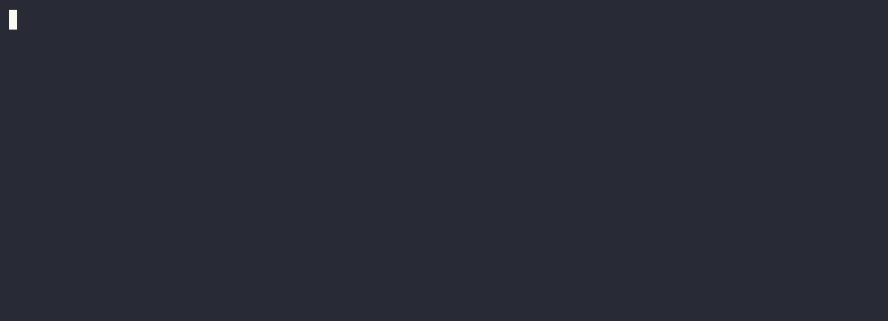

# ValutaTrade Hub

Консольная платформа (CLI) для симуляции торговли фиатными и криптовалютами. Позволяет управлять виртуальным портфелем, следить за актуальными курсами и совершать сделки.

## Описание идеи
Проект состоит из двух логических модулей:
1. **Core Service** — основное приложение (CLI), отвечающее за регистрацию, управление кошельками, бизнес-логику покупки/продажи и безопасность данных.
2. **Parser Service** — сервис для атомарного обновления курсов валют из внешних источников (CoinGecko для криптовалют, ExchangeRate-API для фиатных).

Данные кэшируются локально. Поддерживается политика устаревания кэша (TTL), логирование действий и ротация логов.

## Структура каталогов
- `data/` — локальные JSON-базы (пользователи, портфели, актуальные курсы и история курсов).
- `valutatrade_hub/cli/` — консольный интерфейс пользователя, парсинг аргументов командной строки.
- `valutatrade_hub/core/` — доменные модели (User, Wallet, Portfolio), бизнес-логика (usecases), кастомные исключения и иерархия валют.
- `valutatrade_hub/infra/` — инфраструктурный слой (SettingsLoader Singleton).
- `valutatrade_hub/parser_service/` — логика обращения к API, атомарное сохранение.
- `logs/` — директория логов (ротируемый `actions.log`).

## Установка и запуск
1. Убедитесь, что у вас установлен Python >= 3.12 и менеджер пакетов `uv`.
2. Склонируйте репозиторий и установите зависимости: 
```bash
uv sync
```
3. Создайте файл .env в корне проекта и добавьте ваш ключ от ExchangeRate-API (иначе фиатные курсы будут пропущены):
EXCHANGERATE_API_KEY=ваш_ключ_здесь
4. Запустите приложение:
```bash
uv run main.py
```
## Примеры команд (CLI)
* register --username alex --password 1234 — регистрация.
* login --username alex --password 1234 — вход в систему.
* update-rates — принудительный запуск Parser Service для обновления курсов.
* show-rates --top 3 — вывод 3-х самых дорогих криптовалют из кэша.
* get-rate --from USD --to BTC — просмотр конкретного курса.
* buy --currency BTC --amount 0.05 — покупка актива.
* sell --currency BTC --amount 0.01 — продажа актива.
* show-portfolio --base EUR — просмотр балансов всех кошельков в пересчете на Евро.
* add-fiat --amount 1000 — тестовое пополнение USD баланса для торговли.

## Кэш и политика TTL
* Все получаемые курсы сохраняются в data/rates.json. При запросе курса система проверяет время последнего обновления (last_refresh). Если данные старше заданного порога (TTL, по умолчанию 300 секунд), Core Service автоматически вызывает Parser Service для получения свежих данных. История всех изменений сохраняется в data/exchange_rates.json.

## Демонстрация работы
